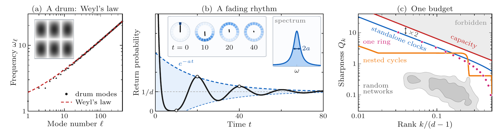
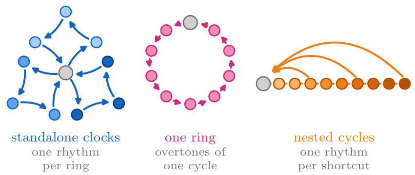

# Can One Hear the Size of a Clock?

**Markus Baumann and Claudia Linnhoff-Popien**
Quantum Applications and Research Laboratory (QAR-Lab), Ludwig-Maximilians-Universität München

[](LICENSE)
[](https://journals.aps.org/prl/)


Source code and data for the Letter and its Supplemental Material: the LaTeX sources, the figures, the
scripts and data that compute and draw every figure, and the reproduction files cited in Sec. VII of the
Supplemental Material.

## The result in one picture

Weyl's law counts the vibration modes that fit into a cavity, so one can hear the area of a drum. Systems
that jump at random between states, from circadian clocks and molecular motors to noisy computing hardware,
keep time with fading oscillations, or rhythms. Their sharpness $Q$ is the ratio of frequency to decay
rate. We find the count for such clocks: a network of $d$ states sustains

```math
N Q < \frac{2(d-1)}{\pi}
```

rhythms sharper than $Q$. All rhythms draw on one budget of states, and a few measured rhythms reveal how
large a hidden clock must be.



*Fig. 2 of the Letter. (a) Weyl's law for a drum. (b) A fading rhythm: probability flows around a ring of
states while its oscillation decays. (c) One budget: no network crosses the capacity (red), the counterpart
of Weyl's law.*

<p align="center"></p>

*Fig. 1: three ways to build many rhythms: standalone clocks, one ring, and nested cycles.*

## Contents

| Path | What it is |
| --- | --- |
| `main.tex` | Letter (REVTeX 4.2, two-column). It ends with `\input{sm}`, so one build gives the Letter followed by the Supplemental Material |
| `sm.tex` | Supplemental Material (pages S1–S12) |
| `refs.bib`, `main.bbl` | One reference list, printed after the Letter and cited by the same numbers in the SM |
| `build.sh` | Full build: pdflatex, bibtex (twice), pdflatex (three times) |
| `wordcount.py` | APS length estimate of the Letter (body, captions, displayed equations, figures) |
| `figs/` | The four figures as printed (vector PDF) |
| `figsrc/` | Scripts that compute the data of Figs. 1–4 and draw them; stored data in `figsrc/data/`; see [`figsrc/README.md`](figsrc/README.md) |
| `repro/` | Reproduction scripts and logs cited in the SM (below) |
| `data/` | Stored results cited in the SM (below) |
| `docs/` | PNG previews of Figs. 1 and 2 for this page |

### Reproduction files (`repro/`)

| File | Reproduces |
| --- | --- |
| `standalone_clocks.py` | Standalone clocks with graded entry rates, Eq. (S4), in 60-digit arithmetic (SM Sec. I A) |
| `sharing_resolution.py` | Distinguishability of the rhythms of nested cycles (SM Sec. III B) |
| `finite_d.py` → `finite_d.log` | Finite chains against standalone clocks, and the drive of shared paths (SM Secs. II C and IV F) |
| `verify_certificates.py` | Exact rational rates and inclusion discs of the two networks that break the per-rhythm drive bound (SM Sec. IV E) |
| `models.py`, `exactcert.py` | Network constructions and exact-arithmetic helpers used by the scripts above |

### Stored data (`data/`)

- `resolved_rhythms.json`: optimized networks (SM Sec. III C)
- `resolved_windows.json`: the 12-state search (SM Sec. III D)
- `worked_example.json`: the hidden machine (SM Sec. VI C)
- Exact rates read by `verify_certificates.py`: `additive_law_witness_d27.json`,
  `additive_law_witness_stalled_d27.json`, `c4_counterexample_d62.json`,
  `per_index_affinity_witness_d11.json`, `near_equilibrium_witnesses.json`

## Reproduce

```bash
./build.sh                                   # main.pdf: Letter (pages 1-6) and SM (S1-S12)
python3 wordcount.py main.tex                # length estimate

cd figsrc && python3 data.py                 # all figure data, about 10 min
python3 fig1.py; python3 fig2.py; python3 fig3.py; python3 fig4.py
cp out/fig*.pdf ../figs/ && cd ..

python3 repro/standalone_clocks.py           # about 6 s
python3 repro/sharing_resolution.py          # about 7 min; writes data/sharing_resolution.json
python3 repro/finite_d.py                    # about 4 min; prints finite_d.log
python3 repro/verify_certificates.py         # about 1 min
```

### Requirements

- pdfLaTeX and BibTeX with REVTeX 4.2 and the `orcidlink` package
- Python 3 with numpy, scipy, mpmath, and matplotlib 3.8–3.10 (3.11.0 drops minus signs from LaTeX
  labels in PDFs)
- For the figure scripts, LaTeX with the `type1cm` and `cm-super` packages (`text.usetex`)

### Names in the reproduction files

The reproduction scripts and `finite_d.log` keep the names of an earlier draft:
- *theta chain* means nested cycles;
- *independent rings*, or *rings glued at a hub*, mean standalone clocks.

In `finite_d.log`:
- "Eq. (2)" is the sharp form of the capacity (Corollary S1);
- `F~_Sigma` is the total drive F_tot of Eq. (5);
- `F_Sigma` is the plain sum of cycle affinities;
- "Eq. (7)" is the earlier bound F_Sigma > π N (Q − 1/Q).

## Citation

```bibtex
@unpublished{baumann2026clock,
  author = {Baumann, Markus and Linnhoff-Popien, Claudia},
  title  = {Can One Hear the Size of a Clock?},
  note   = {Submitted to Physical Review Letters},
  year   = {2026}
}
```

## License and contact

Code and data are released under the [MIT License](LICENSE).
Contact: [markus.baumann@campus.lmu.de](mailto:markus.baumann@campus.lmu.de)
